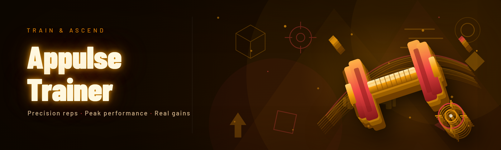

  
  
  

  

  
  

---

Appulse Trainer is shipped as a single self-contained `.exe` for Windows. No runtime, no launcher, no dependencies to install. Everything below reflects the exact matrix I tested on during the 2026 rewrite cycle.

| Platform | Support Level | Notes |
|---|---|---|
| Windows 11 (23H2 / 24H2) | ✅ Full | Default target, all modules verified |
| Windows 10 (21H2+) | ✅ Full | Same module set, minor UI scaling differences |
| Windows Server 2022 | ⚠️ Partial | Core modules work, overlay hooks limited |
| Windows 8.1 | ⚠️ Legacy | Runs, but no overlay and no hotkey rebinding |
| Linux (Wine 9.x) | ⚠️ Experimental | Tested by a contributor, no official support |
| macOS | ❌ Not supported | Out of scope for the current build |

> **Note:** the .exe targets x64 only. There is no 32-bit build and none is planned — every game in the supported catalog is 64-bit.

---

## 🗺️ Roadmap — What Ships Next

Feature | Status | ETA
---|---|---
AI-assisted profile generation | 🧪 In testing | Q2 2026
Real-time config sync across sessions | 🔧 In development | Q2 2026
Per-game module presets | 📋 Planned | Q3 2026
Overlay HUD redesign | 📋 Planned | Q3 2026
Scriptable macro engine (Lua) | 💭 Exploring | Q4 2026
Cloud profile backup | 💭 Exploring | Unscheduled

---

## 📖 What is Appulse Trainer — Glossary

| Term | Explanation |
|---|---|
| **Appulse** | The internal name for the injection-and-hook pipeline the trainer uses to attach to a running game process. |
| **Module** | A single self-contained behavior (aim assist, ESP, recoil control, etc.) that can be toggled independently. |
| **Profile** | A saved bundle of module states + per-module tuning values, portable across sessions. |
| **Overlay** | The in-game HUD drawn on top of the game window, showing active modules and quick toggles. |
| **Hook** | The low-level trampoline that redirects a game function pointer to the trainer's handler. |
| **Signature scan** | Pattern-matching routine used to locate game functions across patches without hardcoded offsets. |
| **Hotkey layer** | The rebindable keymap that maps physical keys to module toggles without conflicting with game binds. |

The trainer is a modular, profile-driven toolkit. You attach it to a game, pick a profile, and every module inside that profile becomes live. Everything is tunable from the overlay; nothing requires a restart.

---

## 🎮 The Problem — Why the Old Way Hurt

- **Static offsets broke on every patch.** You'd spend the first hour of a new update hunting for shifted memory addresses instead of playing.
- **One-size-fits-all configs felt wrong.** A recoil curve tuned for one rifle produced garbage on another; you'd re-tune by hand each session.
- **No overlay meant alt-tabbing.** Every toggle required leaving the game, losing focus, sometimes losing the round.
- **Settings didn't persist.** Crash, restart, or a fresh launch — everything reset to defaults.
- **Injection was all-or-nothing.** A single broken module took the whole process down with it, so you couldn't isolate what failed.

---

## ⬇️ Get the Build

  

---

## 🧩 All Modules — Live Status

| Module | Status | Description |
|---|---|---|
| `pulse-aim` | ✅ Working | Aim smoothing with adjustable curve and deadzone |
| `pulse-esp` | ✅ Working | Box + skeleton ESP with distance falloff |
| `pulse-recoil` | ✅ Working | Per-weapon recoil compensation curves |
| `pulse-trigger` | ✅ Working | Trigger hold with configurable delay |
| `pulse-radar` | ✅ Working | Off-screen enemy indicator ring |
| `pulse-fov` | ✅ Working | FOV circle with soft/hard modes |
| `pulse-wall` | ✅ Working | Wall transparency for occluded targets |
| `pulse-macro` | ✅ Working | Recorded input sequences with replay |
| `pulse-scan` | ✅ Working | Signature scanner for offset recovery |
| `pulse-profile` | ✅ Working | JSON profile import/export |
| `pulse-overlay` | ✅ Working | In-game HUD with live module state |
| `pulse-hotkey` | ✅ Working | Rebindable keymap with conflict detection |
| `pulse-log` | ✅ Working | Structured runtime log viewer |
| `pulse-backup` | ✅ Working | Pre-injection memory snapshot / restore |
| `pulse-ai` | 🧪 Testing | AI-assisted profile suggestions |
| `pulse-sync` | 🔧 Dev | Cross-session config sync |
| `pulse-script` | 💭 Exploring | Lua macro scripting |

---

## 🧠 Tips for Best Results

- Run the .exe **as Administrator** — signature scans need read access to the game process.
- Launch the trainer **after** the game reaches its main menu; injection during loading screens is unreliable.
- Keep one profile per game — mixing profiles across titles causes tune drift.
- Use `pulse-backup` before toggling experimental modules; restore is instant.
- Rebind hotkeys off your game's default binds during first setup, not mid-match.
- Export your profile to JSON before a game patch so you can diff offsets afterward.

---

## 🛠️ Known Issues

| Issue | Fix |
|---|---|
| Overlay flickers in exclusive fullscreen | Switch the game to borderless windowed |
| Hotkey ignored while a menu is open | Menu input is captured by the game; use the overlay toggle |
| `pulse-radar` shows stale dots after respawn | Toggle the module off/on to force a rescan |
| Signature scan fails after a large patch | Update the trainer to the latest nightly build |
| Profile import warns on unknown keys | Safe to ignore; unknown keys are dropped on save |

---

## ⚖️ Comparison — How Appulse Trainer Stacks Up

| Aspect | Alternative (typical trainer) | This Tool |
|---|---|---|
| Offset updates | Hardcoded, breaks on patch | Signature scan auto-recovers |
| Config model | Global settings file | Per-game JSON profiles |
| In-game control | Alt-tab to a window | On-overlay hotkeys |
| Failure isolation | Whole process crashes | Modules toggle independently |
| Tuning | Single fixed curve | Per-weapon / per-module curves |
| Persistence | Resets on restart | Profiles persist and export |

---

## 📦 Installation — Run the Tool

1. **Get the build** — visit the project page and download the latest release package.
2. **Extract** — unzip the archive anywhere outside a protected system folder (e.g. `Documents\Appulse`).
3. **Launch** — right-click the `.exe` and choose *Run as Administrator*.
4. **Attach** — start your game, wait for the main menu, then click *Attach* in the trainer.
5. **Pick a profile** — select or import a profile; modules become live immediately.

---

## 🗂️ Grouped Module Catalog

### 🎯 Aiming — **`pulse-aim`**

| Feature | Effect |
|---|---|
| Smoothing curve | Eases cursor toward target instead of snapping |
| Deadzone | Ignores micro-movements near the crosshair |
| Target priority | Nearest / lowest-HP / head-first selection modes |

### 👁️ Vision — **`pulse-esp`**

| Feature | Effect |
|---|---|
| Box ESP | Draws bounding boxes with distance labels |
| Skeleton ESP | Joint overlay for pose reading |
| Fade by distance | Distant targets dim to reduce clutter |

### 🔫 Weapon Handling — **`pulse-recoil`**

| Feature | Effect |
|---|---|
| Per-weapon curves | Distinct compensation per gun |
| Vertical bias | Prioritizes vertical recoil correction |
| Burst mode | Only compensates during held fire |

### 🧭 Awareness — **`pulse-radar`**

| Feature | Effect |
|---|---|
| Off-screen ring | Marks threats outside view |
| Direction arrow | Points toward nearest enemy |
| Range filter | Hides distant contacts |

### ⚙️ Infrastructure — **`pulse-scan`**

| Feature | Effect |
|---|---|
| Signature matching | Locates functions after patches |
| Offset cache | Speeds up repeat scans |
| Fail-safe | Aborts cleanly on mismatch |

### 🎛️ Control — **`pulse-overlay`**

| Feature | Effect |
|---|---|
| Live module state | Toggle view of every active module |
| Hotkey hints | Shows bound keys inline |
| Minimal footprint | Small, corner-anchored HUD |

---

## 🔬 How It Works

Appulse Trainer operates in three internal stages. First, the **attach stage** opens a handle to the target process and performs a signature scan to locate the functions each module needs — no hardcoded offsets, so a game patch only means a rescan, not a rewrite. Second, the **hook stage** installs trampolines on the located functions and routes their calls through the trainer's handler, which is where module logic runs; each module owns its own handler, so a failing module unloads itself without touching the others. Third, the **overlay stage** spawns a transparent, top-most window that renders the HUD and captures hotkeys, communicating with the core over a lightweight in-process channel. Profiles are plain JSON, loaded at attach time and written back on toggle, which is why config persists across sessions and survives crashes.

---

## 📚 Table of Contents

- [Compatibility](#-compatibility--where-appulse-trainer-runs)
- [Roadmap](#️-roadmap--what-ships-next)
- [What is Appulse Trainer](#-what-is-appulse-trainer--glossary)
- [The Problem](#-the-problem--why-the-old-way-hurt)
- [Get the Build](#️-get-the-build)
- [All Modules](#-all-modules--live-status)
- [Tips for Best Results](#-tips-for-best-results)
- [Known Issues](#️-known-issues)
- [Comparison](#️-comparison--how-appulse-trainer-stacks-up)
- [Installation](#-installation--run-the-tool)
- [Grouped Module Catalog](#️-grouped-module-catalog)
- [How It Works](#-how-it-works)
- [FAQ](#-faq--everything-else)

---

## ❓ FAQ — Everything Else

**1. Is this detectable?**
No guarantee is made either way — it's a hook-based trainer and behaves like one.

**2. Do I need Python or Node installed?**
No. The .exe is self-contained; extract and run.

**3. Why does it need Administrator rights?**
Signature scans and process handles require elevated read access.

**4. Will my profile survive a game patch?**
Yes — profiles persist, though offsets may need a rescan via `pulse-scan`.

**5. Can I run it alongside other tools?**
Usually, but hook conflicts are possible; isolate if you see instability.

**6. Where are profiles stored?**
In a `profiles` folder next to the .exe, as plain JSON.

**7. What happens if a module crashes?**
It unloads itself; other modules keep running.

**8. Is there a mobile or console version?**
No. Windows x64 only.

---

  

Appulse Trainer is a tinkerer's project first — built by someone who got tired of re-hunting offsets after every patch and wanted the whole pipeline documented. The 2026 build folds signature recovery, per-game profiles, and an in-game overlay into one `.exe` you extract and run. If a module breaks, isolate it; if an offset shifts, rescan. That's the whole workflow.
